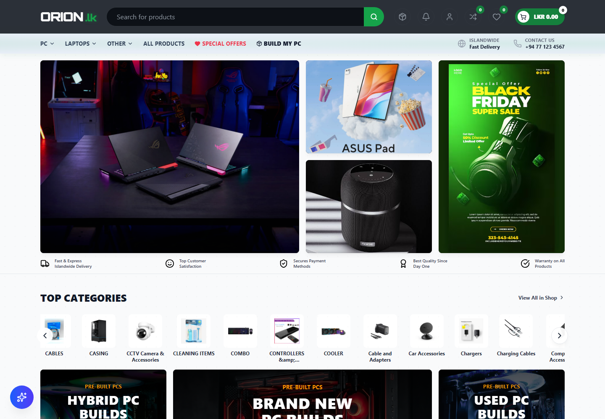
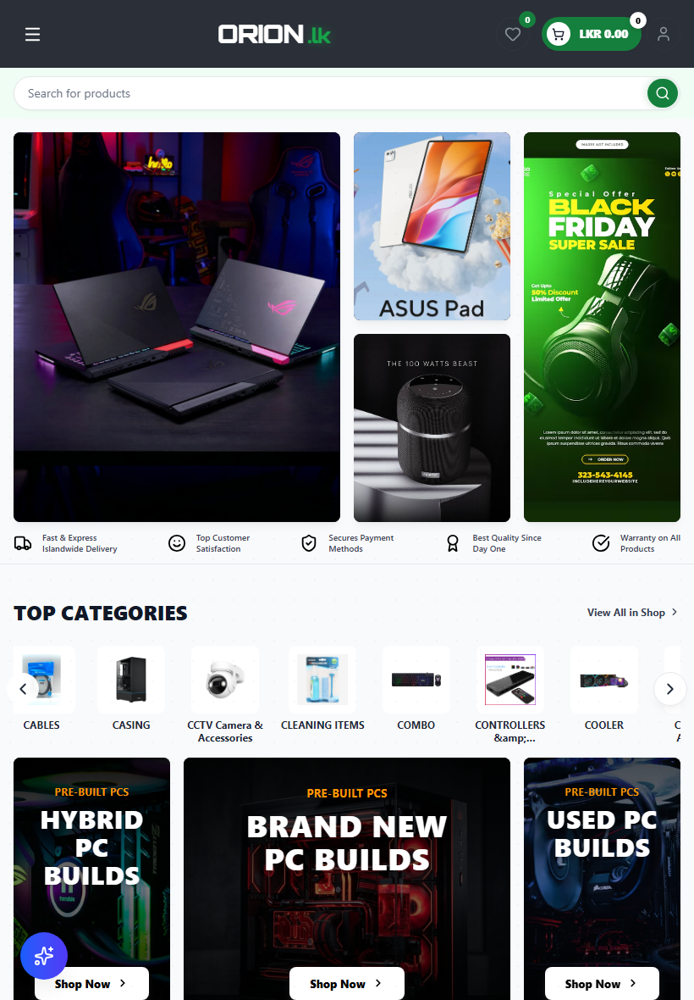
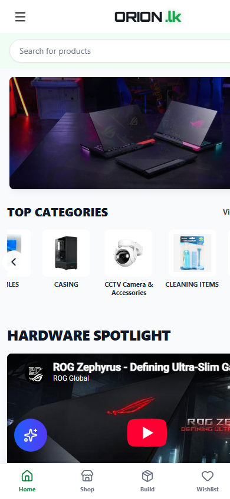

# Orion.LK

Orion.LK is a responsive online store for PC components, laptops, and tech accessories in Sri Lanka. It brings product discovery, PC-building tools, customer accounts, and store management together in one web application, with prices shown in Sri Lankan rupees.

**Live site:** [orion-lk.vercel.app](https://orion-lk.vercel.app/)

## Screenshots

Screenshots below were captured from the running local site at desktop, tablet, and phone viewport sizes. They are stored in this repository so they remain available on GitHub.

| Desktop | Tablet | Mobile |
|---|---|---|
|  |  |  |

## What the site does

- **Discover products:** browse PC parts, laptops, and other products; search, filter, and open detailed product pages.
- **Compare and save:** add products to a wishlist or compare list, and manage items in the shopping cart.
- **Build a PC:** explore PC builds and assemble a component list.
- **Shop offers:** view special offers and featured products.
- **Create an account and order:** register or sign in, proceed through checkout, choose available payment options, and view account/order information.
- **Manage the store:** administrators can manage products, categories, brands, home-page content, offers, orders, reviews, users, and store analytics.
- **Use it on different screens:** responsive layouts adapt the navigation, product browsing, and shopping experience for desktop, tablet, and mobile.

## Why it was built

The project provides a single, locally focused shopping experience for Sri Lankan customers looking for computer hardware and accessories. It combines product information and stock status with browsing, PC-building, and purchase flows, while giving store administrators a place to maintain the catalog and storefront.

## Technology

- **Frontend:** React, TypeScript, Vite, Tailwind CSS, and React Router
- **Mobile app:** Capacitor Android project, buildable with Android Studio
- **Backend:** Next.js API routes
- **Data and services:** MongoDB with Mongoose, Firebase Authentication, and optional Cloudflare R2 image storage
- **Payments:** PayHere integration and a sandbox page

## Run locally

Requirements: Node.js/npm, a MongoDB database, and Firebase project configuration.

1. Configure the frontend environment:

   ```powershell
   cd frontend
   Copy-Item .env.example .env
   ```

   Fill in the Firebase values and set `VITE_API_URL=http://localhost:5000`.

2. Configure the backend environment in `backend/.env.local` with the database connection and required Firebase Admin settings. Add payment or image-storage settings if those services are enabled. Keep credentials out of Git.

3. Install dependencies and start the backend and frontend in separate terminals:

   ```powershell
   cd backend
   npm install
   npm run dev
   ```

   ```powershell
   cd frontend
   npm install
   npm run dev
   ```

   The frontend runs at [http://localhost:3000](http://localhost:3000); the backend API runs at [http://localhost:5000](http://localhost:5000).

## Build Android APK

Android Studio and JDK 21 are required. From the `frontend` directory:

```powershell
npm run build:android
npm run android:open
```

In Android Studio, wait for Gradle sync and choose **Build > Build Bundle(s) / APK(s) > Build APK(s)**. See [frontend/ANDROID_BUILD.md](frontend/ANDROID_BUILD.md) for details.

## Validation

From `frontend`, run:

```powershell
npm run lint
npm run build
```

From `backend`, run:

```powershell
npm run build
```
